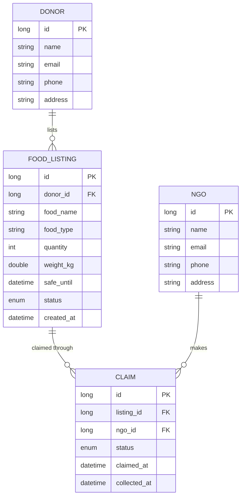

# FoodShare: Surplus Food Donation Matching Platform

Spring Boot 3.3, Java 21, MySQL (XAMPP), HTML/CSS/JS front end.

## Run
1. Start **MySQL** in XAMPP.
2. Open this folder in IntelliJ as a Maven project (JDK 21) and run `FoodShareApplication`.
3. Open http://localhost:8081 . The `foodshare_db` database, tables and sample data are created automatically.

## Layered architecture
`controller` (REST, validation) -> `service` (business rules, expiry, notifications) -> `repository` (Spring Data JPA) -> MySQL.
`exception` holds the `@RestControllerAdvice` that returns clear JSON errors. `dto` holds validated request records.

## ER / class diagram

Listing status: AVAILABLE, CLAIMED, COLLECTED, EXPIRED. Claim status: ACTIVE, COLLECTED, CANCELLED.

## Business rules (enforced in `ClaimService`, before saving)
1. A listing past its safe-to-eat-until time cannot be claimed (HTTP 409).
2. Only one NGO can hold an ACTIVE claim on a listing at a time (HTTP 409).
3. Unclaimed listings are auto-expired by a scheduled job every 30 seconds.

## Endpoints
| Method | Path | Purpose |
|---|---|---|
| GET/POST | /api/donors, /api/ngos | List / create |
| GET/PUT/DELETE | /api/donors/{id}, /api/ngos/{id} | Read / update / delete |
| POST | /api/listings | Donor lists food (quantity, type, safeUntil) |
| GET | /api/listings?status=AVAILABLE&page=0&size=10&sort=safeUntil,asc | NGO browses (paging + sorting) |
| GET/PUT/DELETE | /api/listings/{id} | Read / edit / remove a listing |
| POST | /api/claims | NGO claims a listing |
| PUT | /api/claims/{id}/collect | Mark collected |
| PUT | /api/claims/{id}/cancel | Release the claim |
| GET | /api/reports/diverted-monthly | Food diverted from waste per month |

## Postman test cases
- Create listing: `POST /api/listings` `{"donorId":1,"foodName":"Rice","foodType":"Cooked meal","quantity":20,"weightKg":8,"safeUntil":"2026-10-01T18:00:00"}` -> 201
- Validation: same body with `"quantity":-5` -> 400 with field message
- Past time: `"safeUntil":"2020-01-01T10:00:00"` -> 409 "must be in the future"
- Claim: `POST /api/claims` `{"listingId":1,"ngoId":1}` -> 201
- Double claim: claim listing 1 again with `"ngoId":2` -> 409 "not available / active claim"
- Expired claim: list food expiring in 2 minutes, wait, then claim -> 409; the list shows it as EXPIRED
- Collect: `PUT /api/claims/1/collect` -> 200; collect again -> 409
- Report: `GET /api/reports/diverted-monthly`

Notifications appear in the IntelliJ console with the `NOTIFY` logger name.
